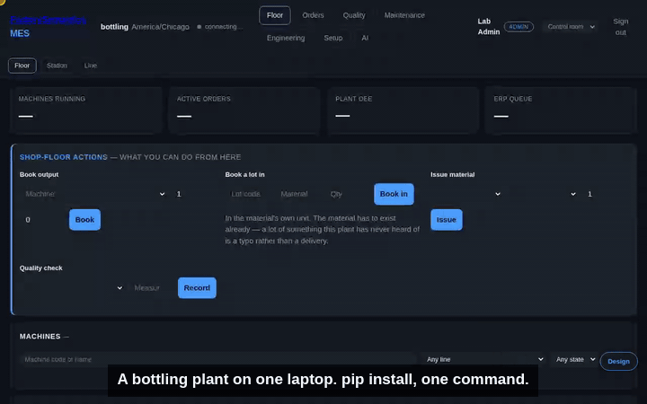

# FactorySemantics MES

An open-source, modular, **agent-native** Manufacturing Execution System.

Run one module on a laptop for a five-person shop, or the full suite across a fleet of plants. Every capability is an API and an agent tool first, a screen second. Every number is honest about where it came from.

**35 seconds on the lab bottling plant: a stop, a sample, a maintenance job, and why each happened.**



> **Status: pre-alpha, 0.4.0, running simulated plants only (as of 2026-10-16).** Orders and routings, OPC UA execution, OEE, quality with SPC and gauges, maintenance, finite-capacity scheduling, serialisation and genealogy, a 95-tool MCP agent surface, an ERPNext connector, and a scoring harness that measures whether the MES told the truth about its plant. **New since 0.2.0:** the plant packs travel inside the package, so `pipx install factorysemantics-mes` and then `fsmes demo bottling` bring up a bottling plant on a machine with no checkout, on Linux and on Windows; an SPC tab with I-MR, X̄/R and p charts where a point can be pressed for the reading, the rules it broke, the gauge, the machine's state and the rest of the line; count data — how many units a lot sent back and what for; maintenance work that reaches the right trade by itself, and a supervisor's screen that reads like a plant; a chat on the AI tab that explains the chart in front of it (it needs `ANTHROPIC_API_KEY` and costs about $0.12 a question; the floor assistant needs a local [Ollama](https://ollama.com)); every floor row carrying the shift it happened on; and a simulated line that plays a whole eight-hour shift with a four-link chain of cause in it — a chiller order nobody started, its outlet climbing, the product reaching the filler colder, fill heights a millimetre and a half low — with no limit broken anywhere, which is the test. [The release page](docs/releases/0.3.0.md) is the whole of it. **New in 0.3.1:** the first run on a Windows PC recovers itself — `py -m fsmes` when the installer's folder is not on PATH, a half-dead plant named process by process by `status`, and `stop` clearing it with no flag; a simulated plant shaped like your own, three commands from a pip install; one folder of plain pages that lets whatever AI assistant you already use walk you through install and shadow mode, with no access to your machine; and `fsmes doctor`, one file to paste when something is wrong, with every value in it replaced by its shape. [The 0.3.1 release page](docs/releases/0.3.1.md) is the whole of that. **New in 0.4.0:** a plant can run as two copies on two boxes against one PostgreSQL and keep counting when one of them dies — the jobs that must run once (reading the machines, the simulated floor, pruning the history) are held one at a time by a lease in the database, the counts carry on rather than starting over, nobody signs in again, and `bash scripts/kill-a-node.sh` brings the whole thing up in Docker and pulls the plug on a node so you can watch it. [The 0.4.0 release page](docs/releases/0.4.0.md) is the whole of that. **Not yet:** a real plant — none has run this, and making a first one possible in shadow mode, beside the MES already in charge, is what shadow mode is for; [the guide](docs/operate/first-plant.md) is written and untried. Also not yet: ERPNext Job Card confirmations — whether Job Card is the right place at all is a question put to the ERPNext community on 2026-09-10 and not yet answered; the thin Frappe app that would list the connector on the Marketplace ([decision 0008](docs/decisions/0008-erp-connectors-are-modules.md)); and PLC write-back beyond a guarded recommendation queue. See [ROADMAP.md](ROADMAP.md) for what has landed and what is next, [docs/ARCHITECTURE.md](docs/ARCHITECTURE.md) for the design, [docs/LANDSCAPE.md](docs/LANDSCAPE.md) for why this project should exist at all, [docs/operate/compatibility.md](docs/operate/compatibility.md) for what has been tested against what and when, and [docs.factorysemantics.com](https://docs.factorysemantics.com) for the documentation.
>
> **Nothing on this page is measured on a real plant.** Every number in this repository comes from a simulated line and says so where it appears.

---

## Why this exists

Three facts, verified 2026-08-28 (sources in [docs/LANDSCAPE.md](docs/LANDSCAPE.md)):

1. **No integrated open-source MES exists.** ERP projects (Odoo, ERPNext, Qcadoo) stop at work orders — no machine connectivity, no OEE, no SPC. Data-infrastructure projects (United Manufacturing Hub, Rhize) deliberately refuse to be the MES. SCADA projects have machine data but no manufacturing semantics. Nothing open-source does gauge/calibration management *at all*. Plants that can't afford a €200k–1.5M commercial MES implementation stitch together Node-RED, Grafana, and spreadsheets — and the ERPNext maintainers themselves published the missing-features list ([erpnext#50827](https://github.com/frappe/erpnext/issues/50827)).

2. **The agent-native lane is open, but the window is closing.** Every incumbent (Siemens, Bosch, Rockwell) is bolting AI agents onto closed platforms. Tulip shipped an MCP server; Ignition announced one for 2026. An MES whose *core* is designed to be operated by agents — permissioned writes, append-only audit, semantic events — with the source open, has no occupant.

3. **This isn't starting from zero.** The kernel came from a working, tested mini-MES (orders, routings, OPC UA machine layer, OEE, ERPNext round-trip) that was merged into this repository on 2026-08-31. The test plant is a deterministic line simulator that lives in `src/fsmes/sim/`. See *Provenance* below.

## The north star

Siemens Opcenter-level functional coverage, as open-source modules on one kernel. The table is the **target**; the marks say how far each item has come as of 2026-10-12 (✅ landed · 🟡 partial · ⬜ not started):

| | | |
|---|---|---|
| ✅ Production orders & routings | ✅ PLC / OPC UA / Kepware connectivity | ✅ Downtime tracking & OEE |
| 🟡 Shifts, calendars & labor | ✅ Quality: inspections, holds, NCR, SPC | ✅ Gauge & calibration management |
| ✅ Preventive maintenance | ✅ Finite-capacity scheduling | ✅ Traceability & genealogy |
| ✅ ERP integration: ERPNext order-level, live in CI; B2MML-flavoured file; REST — no Job Card confirmations, and no SAP, Odoo, Oracle or NetSuite connector | ✅ Analytics & shift reports | 🟡 Agent operations layer (MCP) — 95 tools and the write discipline; the run that puts a real model against the live surface is a command, not a gate |

Honesty about scale: Opcenter is thousands of engineer-years. The path here is not cloning it — it's shipping the **20% of each module that covers 80% of a small-to-mid plant**, correctly and honestly, module by module, with agents as the force multiplier. Depth grows where users pull.

## Principles

1. **Kernel + modules.** A small kernel (master data, orders, routing, dispatch, execution, events, audit, auth) that is always present; everything else — quality, maintenance, scheduling, gauges — is an optional module. A customer installs only what they need.
2. **Standards-shaped, not standards-burdened.** ISA-95 nouns for the data model, PackML for machine states, ISO 22400 for KPIs, B2MML only at the ERP border. Never invent a word the industry already has; never implement an XML schema internally.
3. **Agent-native.** Every function callable via REST and MCP. Read tools are free; command tools are idempotent, support `dry_run`, and pass approval gates. Agents act *on behalf of* an identified human, and every action — human or agent — lands in the same append-only audit spine.
4. **Never invent production.** Counter deltas book production; resets re-baseline and book nothing. OEE reports *unknown*, never a misleading zero. Unlabelled downtime is reported as unlabelled. Every screen states its data source.
5. **Runs anywhere.** SQLite on a laptop → Docker Compose in a plant → fleet of nodes with a console. Operator UI is plain HTML/JS with no build step, because a plant PC must render it for years without a node toolchain.
6. **Simulation-first.** CI runs a full fake plant (deterministic six-station line over a real OPC UA server). Every feature is demoable without hardware. Scripted failures — breakdowns, changeovers, counter resets, micro-stops — are named regression tests.
7. **Config, not code, at every plant boundary.** Which tags a machine exposes lives in a tag map. What a plant enables lives in a plant pack — one directory, validated offline by `fsmes pack check`, carrying no code and no secret. Three lab packs exist to prove it: two that disagree about the line, and a third invented to disagree with the pack format itself and to run the same wheel with two modules switched off.

## Provenance — where the code comes from

This project is a *convergence*, and its origins are recorded deliberately:

| Source | What it contributes | License status |
|---|---|---|
| **MES-TWIN** (the maintainer's earlier personal project) | The kernel: routing/order model, OPC UA agent + tag maps, OEE math, ERP adapters, auth, audit — merged wholesale on 2026-08-31 and built on since | Merged into this repository; Apache-2.0 here |
| **LineSim** (the maintainer's earlier personal project) | The CI/demo plant: deterministic line physics → CSVs → OPC UA replay or Kepware | Ported into `src/fsmes/sim/`; not a dependency |
| **FactorySemantics** (the semantic layer) | The canonical event envelope and manufacturing ontology this MES is meant to emit through its outbox | Not yet a dependency: as of 2026-09-07 the code does not import it (ROADMAP, "carried decision for M1") |
| **factorysemantics.com** | Patterns only: plant packs, capability-filtered MCP tool surface, single-writer locks, observe-don't-push fleet console | Patterns re-implemented here; that code stays there |

**Clean-room rule:** everything here derives from the personal projects above, public standards, and public documentation. Nothing derives from any commercial MES's internals, schemas, or documentation, and no employer data or configuration is ever committed. Domain *understanding* from running an MES daily informs what to build; proprietary *material* does not enter this repository.

## The FactorySemantics family

- **FactorySemantics MES** (this repo) — the execution layer: runs the floor, books production, owns the audit trail.
- **FactorySemantics** — the semantic layer: canonical events and ontology this MES is designed to emit (not yet published; see Provenance).
- **factorysemantics.com** — the commercial layer: on-prem analytics/ML nodes and the fleet console that consume those events.

The MES makes the data; the semantic layer names it; the intelligence layer learns from it.

## Decisions (ratified 2026-08-28)

| Decision | Call | Why |
|---|---|---|
| License | **Apache-2.0** everywhere, contributions under [DCO](CONTRIBUTING.md) | The two closest industrial comparables (United Manufacturing Hub, frePPLe) both *left* copyleft because integrators are the adoption channel; closed-SaaS strip-mining of a niche on-prem MES is a phantom threat. Copyright stays concentrated, so every future option remains open. |
| Package name | dist `factorysemantics-mes`, import `fsmes` | Brand on the index, four keystrokes in code. Both names verified free on PyPI, 2026-08-28. |
| Publication | **Public from 0.1.0, with a fresh history.** The private era (2026-08-28 to 2026-09-07) is summarised in [docs/history/private-era.md](docs/history/private-era.md). | Readiness and permission were kept separate on purpose: the repository went public when a stranger could install it, run a simulated plant, and read why every number is what it is. |
| Governance | **One maintainer, decisions in public.** [GOVERNANCE.md](GOVERNANCE.md), [docs/decisions/](docs/decisions/). | A page that tells the truth beats a committee that does not exist. |

## Getting started

A plant in one command. `bottling` is the six-station ACME beverage line this
project demonstrates: an eight-hour shift replayed over a real OPC UA server,
a simulated floor booking lots and naming its stops, and the operator screens
reading it.

On Linux or macOS:

```bash
pipx install factorysemantics-mes   # or: uv tool install factorysemantics-mes
fsmes demo bottling
```

On Windows:

```powershell
pipx install factorysemantics-mes
fsmes demo bottling
```

If `fsmes` comes back *not recognized* after a `py -m pip install`, or the
plant stops answering and you need to know what to type next,
[run it on your own box](docs/operate/run-it-on-your-own-box.md) is the first
hour on a Windows PC on one page: PATH, is it still running, and a plant that
is alive but silent.

It prints where the plant is — `http://127.0.0.1:8010/dashboard` — and an
account to sign in with. `fsmes demo bottling stop` puts it down;
`fsmes demo machining` is a second plant on 8020. First start copies the pack
out of the package and generates the shift from its seed, which takes seconds;
after that it starts straight away. Everything it writes — the pack copy, the
database, the logs, the generated line data — goes to one per-user directory
(`%LOCALAPPDATA%\fsmes` on Windows, `~/.local/share/fsmes` on Linux,
`~/Library/Application Support/fsmes` on macOS, or wherever `FSMES_HOME`
says). Nothing under the installed package is written to.

`fsmes demo` with no plant is the older built-in story — one order released
against a routing, run down a simulated two-station line over a real OPC UA
server, booked honestly, and completed, all in one process.

CI proves both from the artifact rather than the source, on every pull
request: the `wheel-demo` job (`.github/scripts/demo_from_wheel.sh`) builds
the wheel, installs it into a fresh virtual environment in an empty directory
and runs the story — and refuses a wheel whose `fsmes --version` disagrees
with its own metadata, or that cannot upgrade a database made by the release
before it. The `wheel-plant` job
(`.github/scripts/plant_from_wheel.py`) does the same for the bottling plant,
on **Ubuntu and on Windows**, and then asks the running plant whether sign-in
works, the specifications are there, the OPC port answers, the floor is
watching, and a lot has been counted.

From a checkout, on Linux or macOS:

```bash
python -m venv .venv && .venv/bin/python -m pip install -e ".[dev]"
.venv/bin/fsmes info
.venv/bin/python -m pytest
```

On Windows (plant PCs are Windows, and CI proves it):

```powershell
python -m venv .venv; .venv\Scripts\python -m pip install -e ".[dev]"
.venv\Scripts\fsmes info
.venv\Scripts\python -m pytest
```

**What runs today (2026-10-12, 0.3.0):** simulated plants, each one a [pack](docs/operate/packs.md) — a single directory that answers *which plant is this?*, refused offline by `fsmes pack check` before it touches anything. `fsmes plant all start` brings them all up; `fsmes fleet` manages the plants this installation owns and refuses every other one; `fsmes fleet console` puts them on one page that reads and has no write path. Each plant is a complete MES over a real OPC UA server with its operator screens. `fsmes score <plant>` replays a scripted hour and reports whether the MES booked what the line produced, whether a planned stop was misbooked as downtime, and whether the scripted breakdown was detected. Two MCP servers: the product’s **95** tools and the simulator’s **13**. Ninety-five is every tool-carrying module registered — eleven of the twenty-three modules ship tools — and a pack that switches one off takes its tools away with it; nine of the twenty-three are the kernel and cannot be switched off, fourteen can. The test suite is the gate: CI runs `ruff` and the whole suite on Ubuntu and Windows, Python 3.12 and 3.13, and the suite again on a real PostgreSQL 16.15, on every pull request.

The public demo is the cutlery plant from `labs/cutlery`, simulated, serving a copy of one scored hour. The way in is [factorysemantics.com/demo](https://factorysemantics.com/demo/), which emails a link; `demo.factorysemantics.com` is gated and turns away anyone arriving without one. It runs on one desktop. Nothing there is a real factory.

## Where things are

| | |
|---|---|
| Documentation | [docs.factorysemantics.com](https://docs.factorysemantics.com) — plant, operate, develop, agents |
| Questions and ideas | [GitHub Discussions](https://github.com/factorysemantics/factorysemantics-mes/discussions) |
| Bugs | [Issues](https://github.com/factorysemantics/factorysemantics-mes/issues) — say whether the plant is simulated or real |
| Contributing | [CONTRIBUTING.md](CONTRIBUTING.md) — DCO, house rules, provenance rule |
| Conduct | [CODE_OF_CONDUCT.md](CODE_OF_CONDUCT.md) |
| Security | [SECURITY.md](SECURITY.md) — private reporting, what is and is not in scope |
| Governance | [GOVERNANCE.md](GOVERNANCE.md), [MAINTAINERS.md](MAINTAINERS.md), [docs/decisions/](docs/decisions/) |
| Changes | [CHANGELOG.md](CHANGELOG.md) |
| Licence | [Apache-2.0](LICENSE), with [NOTICE](NOTICE) |
